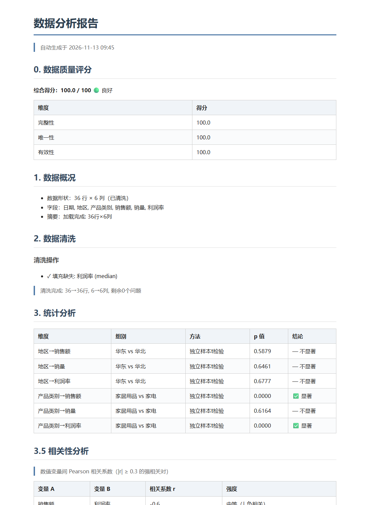
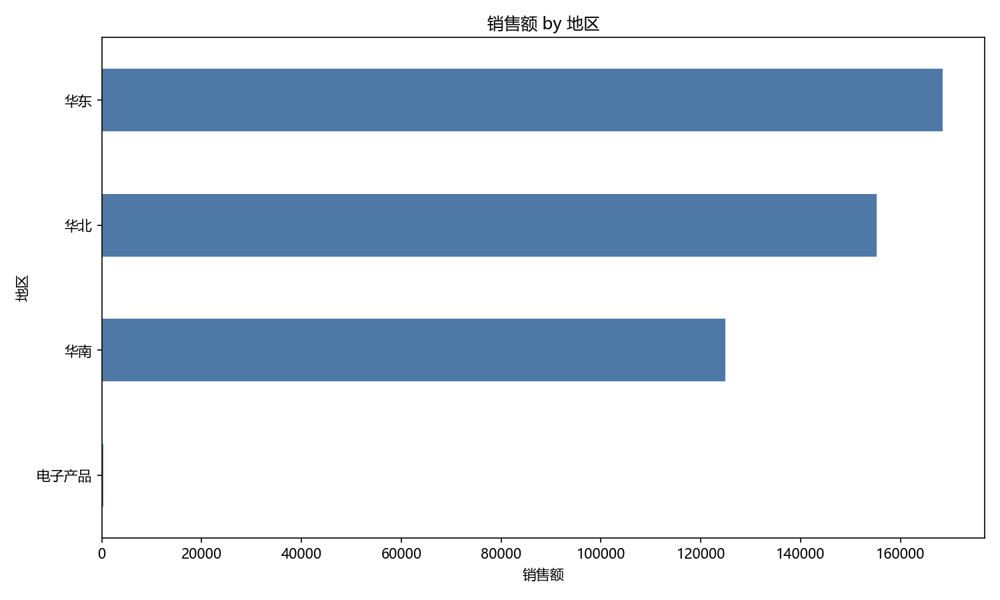
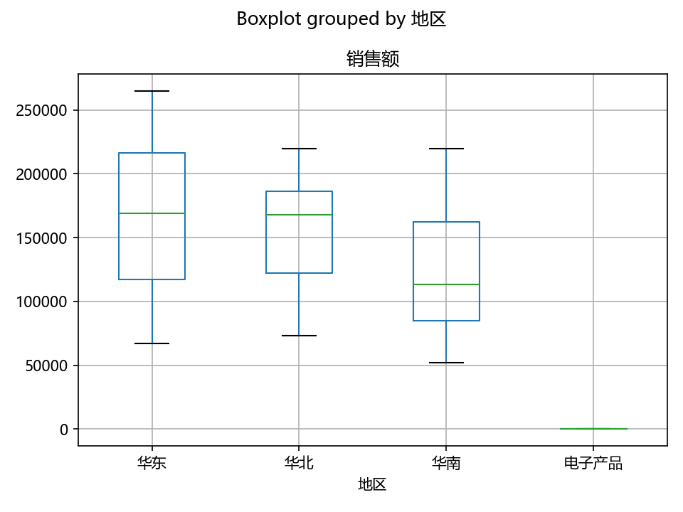
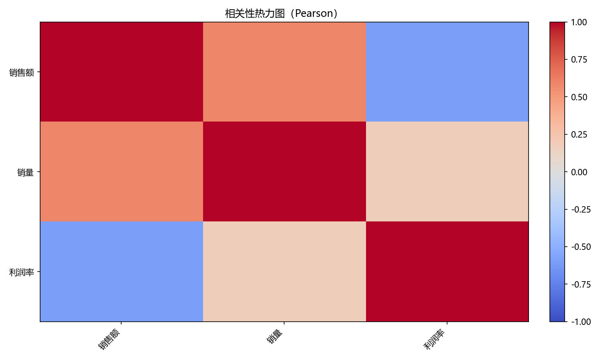

# Data Analysis Agent

[](https://github.com/Hong-lf0719/data-analysis-agent/actions/workflows/ci.yml)
[](https://python.org)
[](../../actions)
[](LICENSE)

📦 **Installable skill**: [csv-insight-report on Agensi](https://www.agensi.io/skills/csv-insight-report) — upload a CSV, get an analyst-grade report, no API key needed.

**上传一份 CSV，拿回一份带假设检验、图表和业务结论的分析报告。**

> **Upload a CSV, get back a report with hypothesis tests, charts, and business findings.**
> Agent-native: ships an open-standard [`SKILL.md`](SKILL.md) — load this repo in Claude Code, Cursor, Codex CLI, or any skill-compatible agent and it runs the full pipeline. ([6 sub-skills](skills/) · [99-line validation rules](docs/质量防线.md))

LangGraph 决策引擎按数据状态动态路由；LLM 不可用、返回异常 JSON 或 API 超时时自动降级为确定性流程，**报告照常产出**。

[看一份真实跑出来的报告](docs/真实运行报告.md) · [12,003 行岗位数据报告](examples/示例报告.md) · [浏览器直接打开的 HTML 版](docs/screenshots/报告预览.html) · [质量防线](docs/质量防线.md)



| 输入 | 输出 |
|---|---|
| 一份 CSV（自动识别编码与分隔符；结构性损坏的文件自动切换干净数据源） | 质量评分 → 清洗 → 假设检验 → 相关性 → 图表 → 业务洞察 → MD / HTML / PDF / Word |

---

## 30 秒跑起来

```bash
pip install -r requirements.txt
cp .env.example .env                 # 可选，不配 Key 也能跑（走确定性降级）
python agent.py examples/sample_sales.csv
streamlit run app.py                 # Web UI，支持多轮追问
docker compose -f deploy/docker-compose.yml up web
```

CLI 在非交互环境（CI / 管道）无输入时自动结束，不会卡在追问循环；多轮追问走 Web UI。

---

## 一次真实运行长什么样

用 `examples/sample_sales.csv` 跑出来的产物，全部可由 `python scripts/generate_demo.py` 重新生成，不是占位图：

| 阶段 | 产物 |
|---|---|
| 质量评分 | 100.0 / 100（完整性 / 唯一性 / 有效性） |
| 数据清洗 | 识别利润率缺失 1 条并中位数填充，36 行 × 6 列 |
| 统计分析 | 6 组假设检验，自动选 t-test / Mann-Whitney，含 p 值与结论 |
| 可视化 | 柱状图 / 箱线图 / 相关性热力图 3 张 |
| 业务洞察 | 3 条关键发现 + 3 条可执行建议 |

  

---

## 核心能力

| 能力 | 说明 |
|---|---|
| 动态决策 | LangGraph 状态机，按数据状态路由；LLM 反复返回同一动作也会强制推进 |
| 智能加载 | 自动检测编码 / 分隔符；中文乱码有统一读取入口，绝不回退 latin-1 |
| 数据质量门禁 | `quality_score` 三维度 0–100 分；列错位的坏文件自动切换到干净数据源 |
| 统计分析 | 正态性检验 → 自动选 t-test / Mann-Whitney，含效应量与显著性结论 |
| 可视化 | 按数据特征自动选柱状 / 箱线 / 分布 / 热力图，纯分类数据也有频次图兜底 |
| 报告与导出 | 结构化报告 + LLM 业务洞察，导出 Markdown / 自包含 HTML / PDF / Word |
| 健壮降级 | LLM 失效不崩溃，analyze / clean / report 节点均有确定性兜底 |
| 部署 | Docker 一键启动 Web UI |

---

## 质量防线

「TDD for Skills」不是口号：**99 行 `skills/SKILL.md` 校验规则**约束 AI 生成行为，代码层线性状态机兜住模型跑偏，**60 项 pytest** 把路由终止、编码、清洗、统计、导出、状态持久化全部锁成可回归资产。

每次 push / PR 由 GitHub Actions 在 Python 3.10 / 3.11 下自动跑：

```bash
pytest tests/ -q --cov=tools --cov=agent     # 60 passed
```

完整口径、已修复的真实缺陷清单见 [docs/质量防线.md](docs/质量防线.md)。

---

## 性能

固定随机种子合成数据、LLM 离线打桩，测确定性管线耗时：

| 数据行数 | 耗时 | 报告长度 | 图表数 |
|---:|---:|---:|---:|
| 634 | 0.53 s | 1,380 字符 | 3 |
| 5,000 | 0.67 s | 1,383 字符 | 3 |
| 12,003 | 0.85 s | 1,385 字符 | 3 |

**管线本身不到 1 秒，端到端耗时几乎全在 LLM 调用上**——这也是为什么要做无 Key 降级：模型慢或挂了，分析不该跟着停。

复现：`python scripts/benchmark.py`，口径与环境见 [docs/benchmark.md](docs/benchmark.md)。

> 简历里的「端到端 12–21 秒（实测 634~12003 行）」是**含 LLM 生成**的历史实测，与上表口径不同，不可直接对比。

---

## 架构

```
用户：分析 data.csv
    │
    ▼
┌──────────────────────────────────┐
│   LangGraph 决策引擎（agent.py）   │
│   analyze ← LLM 每步动态决策       │
│      │                           │
│   load → clean → stats → viz     │
│              → report            │
│   代码层强制路由 + 节点级降级兜底  │
└──────────────────────────────────┘
    │
    ▼
📄 分析报告 + 📊 图表 + 📤 多格式导出
```

## 项目结构

```
data-analysis-agent/
├── agent.py            ← LangGraph 决策引擎 / CLI 入口
├── app.py              ← Streamlit Web UI
├── tools/              ← 加载 / 清洗 / 统计 / 可视化 / 报告 / 导出 / 质量评分
├── skills/             ← 子 skill 定义 + 99 行校验规则
├── tests/              ← 60 项 pytest
├── examples/           ← 示例数据、示例报告与使用说明
├── docs/               ← 质量防线、性能基准、真实运行报告与截图
├── scripts/            ← generate_demo.py / benchmark.py（可复现产物）
├── deploy/             ← Dockerfile + docker-compose
└── .github/workflows/  ← CI
```

## 我的其他项目

- [Hermes Sentinel](https://github.com/Hong-lf0719/Hermes-Sentinel) — 多渠道 AI 情报助手（FastAPI + DeepSeek + RAG + 岗位雷达），端到端可跑的 Agent 系统。

## License

MIT
